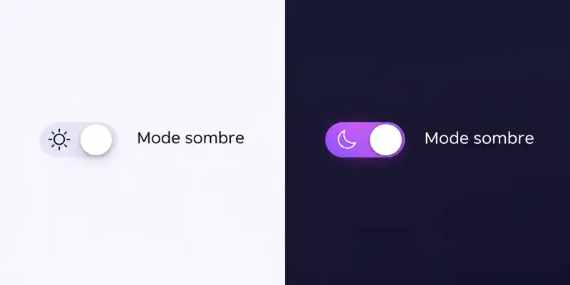

# Tailwind Dark Mode Toggle

Un interrupteur clair/sombre minimaliste, accessible et animé avec **Tailwind CSS**, CSS et JavaScript natif.

## Aperçu



## Structure du projet

```text
.
├── index.html
├── assets/
│   ├── images/
│   │   └── dark-mode-preview.webp
│   ├── css/
│   │   └── styles.css
│   └── js/
│       ├── theme-init.js
│       ├── tailwind.config.js
│       └── theme.js
├── LICENSE
└── README.md
```

- **`index.html`** : structure et classes utilitaires Tailwind ; aucun code CSS ou JavaScript intégré.
- **`assets/css/styles.css`** : animation du bouton, icônes et prise en charge du mouvement réduit.
- **`assets/js/theme-init.js`** : application anticipée du thème pour limiter le clignotement au chargement.
- **`assets/js/tailwind.config.js`** : configuration de Tailwind (mode sombre par classe).
- **`assets/js/theme.js`** : gestion de l'interrupteur, accessibilité et persistance des préférences.

## Fonctionnalités

- Basculement clair / sombre avec animation de glissement et icônes soleil/lune en SVG inline
- Préférence utilisateur sauvegardée dans `localStorage`
- Préférence système utilisée en l'absence de choix enregistré
- Contrôle natif utilisable au clavier avec indication de focus
- Animations limitées lorsque `prefers-reduced-motion` est activé
- Aucun framework JavaScript, gestionnaire de paquets ou image nécessaire

## Utilisation

Ouvrez `index.html` dans un navigateur connecté à Internet. Vous pouvez aussi lancer un serveur statique local :

```bash
python -m http.server 8000
```

Puis ouvrez `http://localhost:8000`.

## Origine et hébergement

Copie du [projet source](https://github.com/Niuwebpro/tailwind-dark-mode-toggle), commit `547f0730e0c94a34d43ffbbf508fe537b8a40000`. La licence et les ressources d’origine sont conservées. Cette copie n’est pas synchronisée automatiquement avec le dépôt source.

Le projet se trouve maintenant dans `standalone/tailwind-dark-mode-toggle/`. Pour un hébergement statique, publier le contenu de ce dossier. Aucun déploiement GitHub Pages n’est configuré par cette intégration.

## Personnalisation

- **Couleur du switch :** remplacer la classe `peer-checked:bg-violet-600` dans `index.html`.
- **Dimensions :** adapter `h-8 w-14`, `h-6 w-6` dans le HTML et la translation de `24px` dans `styles.css`.
- **Comportement du thème :** adapter `theme-init.js` et `theme.js`.

> **Production :** le CDN Tailwind Play est prévu pour les démonstrations. Pour un site de production, utilisez une version compilée de Tailwind CSS et retirez le script CDN.

## Licence

MIT — voir [LICENSE](LICENSE).
